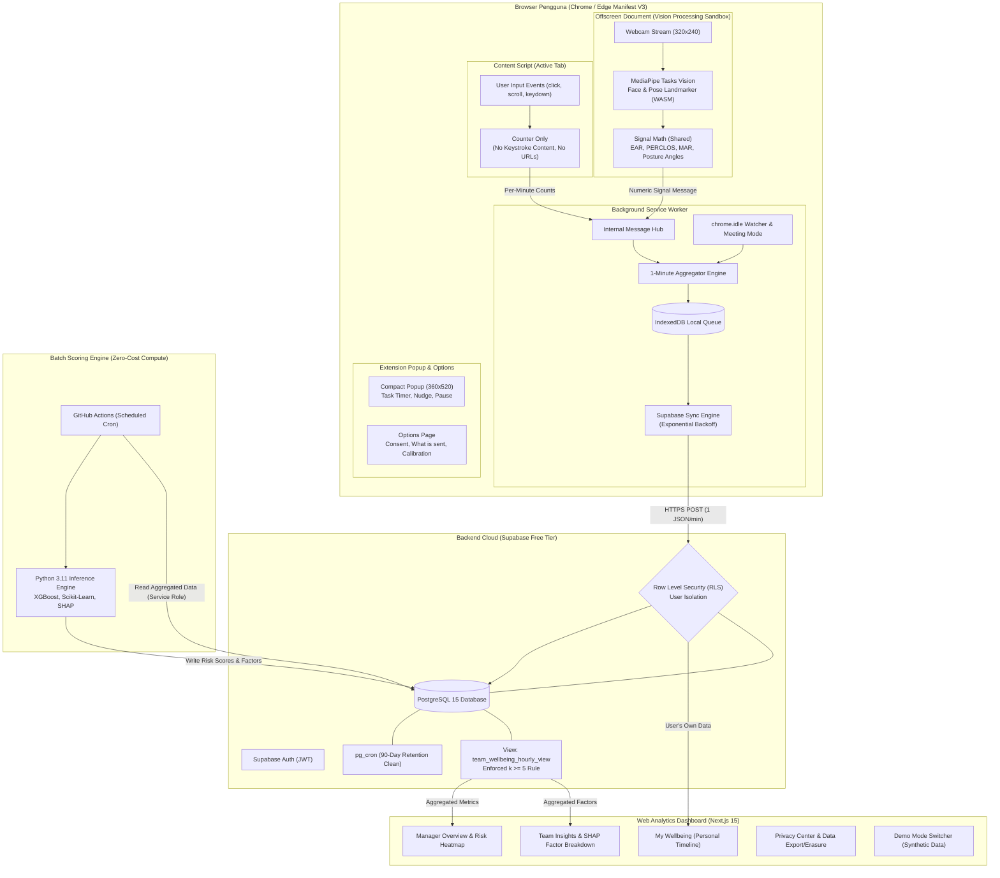

# Arsitektur Sistem (System Architecture) — "Selaras"

Dokumen ini menjelaskan rancangan arsitektur tingkat tinggi dan detail teknis implementasi platform **Selaras**.

---

## 1. Diagram Arsitektur Komponen

---

## 2. Rincian Lapisan Sistem

### 2.1 Browser Extension (Manifest V3)

- **Offscreen Document (`offscreen/`)**:
  Manifest V3 membatasi akses DOM dan API `navigator.mediaDevices.getUserMedia` di dalam Service Worker. Selaras mengatasinya secara elegan melalui _Offscreen Document API_. Dokumen ini mengelola stream webcam beresolusi rendah ($320 \times 240$) dan menjalankan model `@mediapipe/tasks-vision` (WASM + file model `.task` yang di-bundle secara lokal).
- **Frame Rate Adaptif (CPU Budget Target < 5%)**:
  Pemeriksaan frame diatur secara dinamis pada rentang 2–5 fps. Jika pengguna dalam status _idle_ (`chrome.idle`) atau mengaktifkan _Meeting Mode_, pemrosesan kamera langsung dijeda untuk menghemat baterai laptop.
- **Content Script (`content.ts`)**:
  Hanya bertugas menghitung frekuensi kejadian interaksi (`clicks`, `scrolls`, `keydowns`). Content script **tidak pernah** menyimpan nilai tombol yang ditekan atau membaca URL dokumen.
- **Service Worker (`background.ts`)**:
  Mengakumulasi data dari offscreen document dan content script setiap 60 detik. Data disimpan terlebih dahulu ke `IndexedDB` sebagai antrean lokal _offline-first_. Jika koneksi internet terputus, data tetap aman dan akan disinkronkan secara otomatis saat online kembali.

### 2.2 Backend & Data Security (Supabase)

- **Autentikasi & RLS**:
  Klien berinteraksi menggunakan JWT Supabase Auth. Setiap tabel dilindungi oleh kebijakan RLS (Row Level Security):
  - Karyawan hanya memiliki akses baca/tulis ke baris miliknya (`auth.uid() = user_id`).
  - Manajer **TIDAK** memiliki akses baca langsung ke tabel telemetri mentah (`signal_minutes`) bawahan.
- **Penegakan k-Anonymity di Level Database ($k \ge 5$)**:
  Manajer hanya diizinkan membaca data melalui PostgreSQL View `team_wellbeing_hourly_view`. View ini memiliki klausul `HAVING COUNT(DISTINCT user_id) >= 5`. Jika anggota tim yang aktif kurang dari 5 orang, query menghasilkan 0 baris, menjamin identitas pekerja di tim kecil tidak dapat ditebak.
- **Retensi Otomatis 90 Hari**:
  Ekstensi PostgreSQL `pg_cron` secara berkala menjalankan rutinitas pembersihan data menit mentah lebih dari 90 hari, menjaga kapasitas basis data tetap berada di bawah batas gratis 500 MB.

### 2.3 Batch Scoring Machine Learning (GitHub Actions)

- Alih-alih menyewa server komputasi awan yang mahal, Selaras memanfaatkan kuota gratis 2,000 menit/bulan dari **GitHub Actions**.
- Sebuah workflow cron terjadwal menjalankan skrip Python 3.11 yang:
  1. Mengambil agregat telemetri per jam dari Supabase.
  2. Menerapkan normalisasi $z$-score terhadap baseline personal masing-masing pengguna.
  3. Menghitung tingkat risiko kelelahan dan nilai atribusi faktor SHAP (_Shapley Additive Explanations_).
  4. Menuliskan skor risiko kembali ke tabel `risk_scores` di Supabase.

### 2.4 Web Dashboard (Next.js 15)

- Menggunakan **Next.js 15 App Router** dengan pendekatan desain "Calm Tech".
- Menyediakan visualisasi responsif dengan Recharts dan transisi mikro menggunakan Framer Motion.
- Dilengkapi **Demo Mode** yang dapat langsung menampilkan data sintetis realistis tanpa harus melakukan konfigurasi Supabase awal, memudahkan presentasi dan evaluasi akademik.
